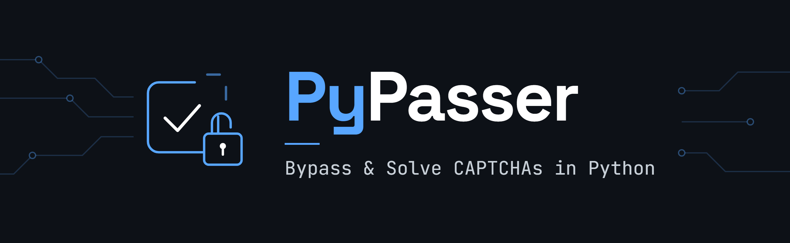
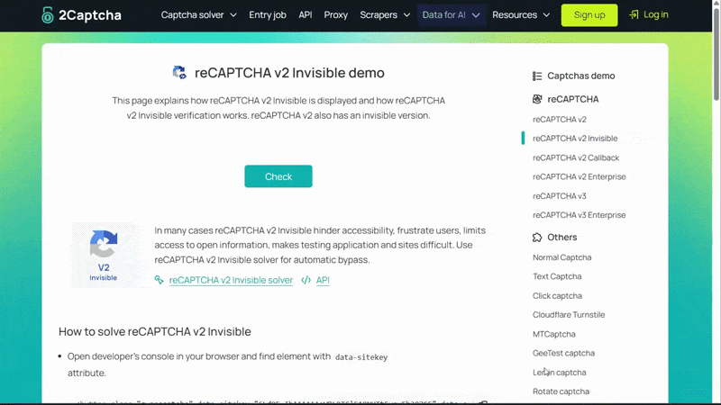
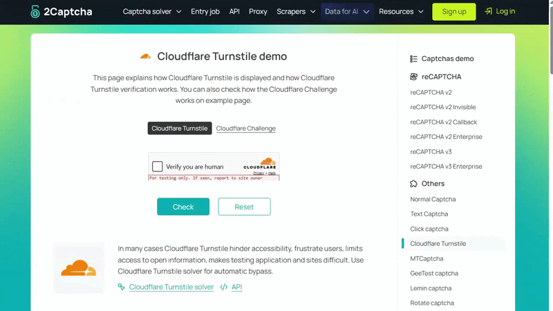

<p align="center">
  <h1 align="center">PyPasser</h1>
  <p align="center">
    Bypass & solve CAPTCHAs in Python — reCAPTCHA V3 over pure HTTP, V2 via audio,
    Cloudflare Turnstile, ARCaptcha, and clear anti-bot walls for cookie replay.
  </p>
  <p align="center">
    <a href="https://pypi.org/project/PyPasser/"></a>
    
    
    <a href="https://github.com/xHossein/PyPasser/blob/master/LICENSE"></a>
    
  </p>
</p>

---

<p align="center"></p>

**PyPasser** is a Python library for bypassing and solving CAPTCHAs. Its main
trick is bypassing reCAPTCHA V3 with **plain HTTP requests** — no browser, no
JS engine, just a single function call that returns a valid token. For
challenges that do need a browser (reCAPTCHA V2, Cloudflare Turnstile), it
drives one with [Patchright](https://github.com/Kaliiiiiiiiii-Vinyzu/patchright)
(recommended) or any Playwright-compatible engine and handles the interaction
automatically.

It also clears the full-page anti-bot walls that Cloudflare and ArvanCloud put
in front of entire sites, returning clearance cookies you can replay over plain
HTTP — solve once in a browser, then make all your requests without one.

> **Python >= 3.9**


---

## Table of Contents

- [Installation](#installation)
- [Supported Solvers](#supported-solvers)
- [reCAPTCHA V3 — Pure HTTP Bypass](#recaptcha-v3--pure-http-bypass)
- [reCAPTCHA V2](#recaptcha-v2)
- [Cloudflare Turnstile](#cloudflare-turnstile)
- [Cloudflare Antibot (Interstitial) Solver](#cloudflare-antibot-interstitial-solver)
- [ArvanCloud Antibot (Interstitial) Bypass](#arvancloud-antibot-interstitial-bypass)
- [ARCaptcha Bypass](#arcaptcha-bypass)
- [Best Practice: Solve Once, Replay Over HTTP](#best-practice-solve-once-replay-over-http)
- [Browser Engines](#browser-engines)
- [Engine Compatibility Table](#engine-compatibility-table)
- [Live Benchmark](#live-benchmark)
- [Exceptions](#exceptions)
- [Roadmap](#roadmap)
- [License](#license)
- [Disclaimer](#disclaimer)

---

## Installation

```bash
pip install PyPasser
```

Install extras based on what you need:

```bash
pip install "PyPasser[stealth,speech]"    # browser solves + audio (most common)
pip install "PyPasser[stealth,speech,vision]"  # + ARCaptcha puzzle support
pip install "PyPasser[all]"               # everything
```

| Extra | What it adds | Used by |
| ----- | ------------ | ------- |
| `browsers` | Playwright | V2, Turnstile, Cloudflare wall |
| `stealth` | Patchright + Camoufox | Recommended for all browser solves |
| `speech` | vosk + ffmpeg + pydub | V2 audio challenge, ARCaptcha voice |
| `vision` | Pillow + NumPy | ARCaptcha slider puzzle |
| `all` | Everything above | |

After installing a browser extra, download the browser binary once:

```bash
patchright install chromium    # recommended engine
# or: playwright install chromium
# or: camoufox fetch
```

---

## Supported Solvers

| Solver | Method | Browser needed? |
| ------ | ------ | :-------------: |
| reCAPTCHA V3 | HTTP bypass — forges a token from the anchor URL | No |
| reCAPTCHA V2 (checkbox, invisible, callback, enterprise) | Clicks the checkbox, transcribes audio with vosk | Yes |
| Cloudflare Turnstile | Clicks the widget checkbox, polls for the token | Yes |
| Cloudflare Antibot (Interstitial) | Clears the "Just a moment..." wall → `cf_clearance` cookie | Yes (headed only) |
| ArvanCloud Antibot (Interstitial) | Decodes the JSFuck challenge in pure Python → clearance cookies | No |
| ARCaptcha (puzzle, voice, grid) | Speaks the ARCaptcha HTTP API directly | No |

Every solver has a **sync** (`solve`) and **async** (`asolve`) version with the
same arguments, and every solver returns a `SolverResult`:

```python
result.is_solved       # bool
result.response_token  # str or None — the token to submit
result.cookies         # dict or None — clearance cookies (anti-bot walls)
result.user_agent      # str or None — the UA those cookies are bound to
```

---

## reCAPTCHA V3 — Pure HTTP Bypass

V3 never shows a visual challenge. The only thing you need is the **anchor URL**
from the page's reCAPTCHA iframe — after that, every solve is a plain HTTP
request. No browser, no JavaScript engine.

### From an anchor URL

Open DevTools on the target site → Network tab → filter `anchor` → copy the
anchor link (iframe `src`):

```
https://www.google.com/recaptcha/api2/anchor?ar=1&k=SITE_KEY&co=...
```

Then:

```python
from pypasser.captcha import recaptcha

result = recaptcha.v3.solve("ANCHOR_URL")
print(result.response_token)  # submit as g-recaptcha-response
```

Enterprise anchors (`/enterprise/anchor`) work the same way.

### Page mode

If you don't want to copy the anchor manually, open the page in a browser and
let PyPasser mine it:

```python
from patchright.sync_api import sync_playwright
from pypasser.captcha import recaptcha

with sync_playwright() as p:
    page = p.chromium.launch().new_page()
    page.goto("https://site-with-recaptcha-v3.com")
    result = recaptcha.v3.solve(page)
```

### Parameters

| Parameter | Default | Description |
| --------- | ------- | ----------- |
| `anchor_url` | — | The reCAPTCHA iframe `src` |
| `proxy` | `None` | Proxy URL (`http`, `socks5`, etc.) |
| `timeout` | `20` | Request timeout in seconds |

Proxy schemes: `http`, `https`, `socks4`, `socks4a`, `socks5`, `socks5h`.
SOCKS support comes from `httpx[socks]`, included with PyPasser.

> **About scores:** The V3 score is decided by Google's risk engine and
> dominated by IP reputation and request volume. PyPasser re-resolves the
> render version from Google's `api.js` on every solve so a stale version never
> gets sent, but the score itself is largely out of your control — especially
> from datacenter IPs. Anchors also expire within minutes (Google rotates the
> `ar` session token), so mine a fresh one per run.

Examples: [`v3.py`](examples/recaptcha/v3.py) ·
[`v3_http.py`](examples/recaptcha/v3_http.py) ·
[`v3_enterprise.py`](examples/recaptcha/v3_enterprise.py)

---

## reCAPTCHA V2

Drives a real browser, clicks the reCAPTCHA checkbox, and if Google serves
the audio challenge, transcribes it with vosk (offline, ~40 MB English model
downloads on first use). On a good IP the checkbox click alone often passes —
the audio path is the fallback.

<p align="center"></p>

```bash
pip install "PyPasser[stealth,speech]" && patchright install chromium
```

```python
from patchright.sync_api import sync_playwright
from pypasser.captcha import recaptcha

with sync_playwright() as p:
    page = p.chromium.launch(headless=False).new_page()
    page.goto("https://www.google.com/recaptcha/api2/demo")
    result = recaptcha.v2.solve(page)
```

All four V2 variants use the same `solve()` call — the difference is how the
page triggers the challenge:

| Variant | What to do before `solve()` | Example |
| ------- | --------------------------- | ------- |
| Checkbox | Nothing — just navigate | [`v2.py`](examples/recaptcha/v2.py) |
| Invisible | Click the page's own button to trigger it | [`v2_invisible.py`](examples/recaptcha/v2_invisible.py) |
| Callback | Nothing — the page reacts via a JS callback | [`v2_callback.py`](examples/recaptcha/v2_callback.py) |
| Enterprise | Nothing — same as checkbox, enterprise key | [`v2_enterprise.py`](examples/recaptcha/v2_enterprise.py) |

### Parameters

| Parameter | Default | Description |
| --------- | ------- | ----------- |
| `backend` | `"auto"` | `"auto"`, `"playwright"`, `"patchright"` or `"camoufox"` |
| `play` | `True` | Whether to click the audio play button |
| `attempts` | `3` | Max solving rounds (Google sometimes asks for multiple) |
| `timeout` | `10` | Seconds to wait for the token after the checkbox is checked |

> **Use Patchright.** Vanilla Playwright leaks automation signals
> (`navigator.webdriver`, `Runtime.enable`) and Google reacts with a block page
> mid-solve (raised as `IpBlock`). Patchright patches those signals out.
> Solving many audio challenges in a row from the same IP also triggers
> `IpBlock` — rotate IPs for volume work.

---

## Cloudflare Turnstile

Solves the Turnstile widget embedded in a page and returns the token. This is
for the **widget** (the checkbox inside a page) — for the full-page "Just a
moment..." wall, see [Cloudflare Antibot (Interstitial) Solver](#cloudflare-antibot-interstitial-solver).

<p align="center"></p>

```python
from patchright.sync_api import sync_playwright
from pypasser.captcha import turnstile

with sync_playwright() as p:
    page = p.chromium.launch(headless=False).new_page()
    page.goto("https://example.com/with-turnstile")
    result = turnstile.solve(page)
    print(result.response_token)  # submit as cf-turnstile-response
```

### Parameters

| Parameter | Default | Description |
| --------- | ------- | ----------- |
| `backend` | `"auto"` | `"auto"`, `"playwright"`, or `"patchright"` |
| `attempts` | `3` | Checkbox-click retries (Cloudflare repaints the widget) |
| `timeout` | `30` | Total solve budget in seconds |

The token lives for **300 seconds**, is **single-use** (one validation), and is
**not** tied to a User-Agent. If the site's backend passes `remoteip` to
Cloudflare's Siteverify, the token is tied to the solving IP.

---

## Cloudflare Antibot (Interstitial) Solver

Clears the full-page Cloudflare challenge ("Just a moment...") and returns the
`cf_clearance` cookie for HTTP replay. The challenge is internally a Turnstile
widget, but the solver enforces the clearance contract — if the wall passed
without issuing a `cf_clearance` cookie, it raises `CloudflareClearanceError`
instead of returning something you can't use.

**This requires a headed browser (Patchright recommended).** Headless does not work — Cloudflare detects
headless below the fingerprint layer (tested across four engine configurations:
patchright, camoufox with two fingerprints, full Chromium new-headless).

<p align="center"></p>

```python
from patchright.sync_api import sync_playwright
from pypasser.antibot import cloudflare

with sync_playwright() as p:
    page = p.chromium.launch(headless=False).new_page()  # must be headed
    page.goto("https://protected-site.com")
    result = cloudflare.solve(page, timeout=60)

# result.cookies  → {'cf_clearance': '...', ...}
# result.user_agent → the UA the cookie is bound to
```

### Parameters

| Parameter | Default | Description |
| --------- | ------- | ----------- |
| `backend` | `"auto"` | `"auto"`, `"playwright"`, or `"patchright"` |
| `attempts` | `3` | Widget-pass retries |
| `timeout` | `60` | Total budget in seconds |

Example: [`interstitial.py`](examples/cloudflare/interstitial.py)

---

## ArvanCloud Antibot (Interstitial) Bypass

ArvanCloud puts a JS-only interstitial in front of Iranian sites. The challenge
page hides cookie values in a JSFuck expression — PyPasser decodes it in pure
Python, no browser or Node.js required.

```python
from pypasser.antibot import arvancloud

result = arvancloud.solve("https://example.ir/protected")
# result.cookies → {'__arcsjs': '...', '__arcsjsc': '...'}
```

### Parameters

| Parameter | Default | Description |
| --------- | ------- | ----------- |
| `url` | — | Any page of the protected site |
| `proxy` | `None` | Proxy URL (clearance is tied to exit IP) |
| `timeout` | `30` | Per-request timeout in seconds |
| `attempts` | `3` | Decode/replay retries |
| `user_agent` | Chrome UA | Must match when replaying cookies |

Example: [`interstitial.py`](examples/arvancloud/interstitial.py)

---

## ARCaptcha Bypass

Speaks the ARCaptcha API protocol directly — no browser. Handles puzzle
sliders, voice clips, and grid challenges over HTTP.

```bash
pip install "PyPasser[speech,vision]"  # voice transcription + puzzle solving
```

```python
from pypasser.captcha import arcaptcha

result = arcaptcha.solve("SITE_KEY", domain="example.ir")
print(result.response_token)  # submit as arcaptcha-token
```

**Challenge types:**

| Type | How it's solved |
| ---- | --------------- |
| `puzzle` | Slider matching with Pillow + NumPy |
| `question` | Falls back to the API's voice variant for the same key |
| `voice` | Persian speech transcribed with vosk (~1.6 GB model, auto-downloads) |
| `cookie` / `accept` | Server-side pass — the challenge ID is the token |
| `block` | Retries with a fresh session, then raises `ARCaptchaBlocked` |

Page mode reads the token the site's own widget produced, or solves over HTTP
and fills the hidden `arcaptcha-token` input:

```python
result = arcaptcha.solve(page, site_key="SITE_KEY", domain="example.ir")
```

### Parameters

| Parameter | Default | Description |
| --------- | ------- | ----------- |
| `site_key` | — | The site's ARCaptcha key |
| `domain` | — | Domain registered for the key |
| `proxy` | `None` | Proxy URL |
| `timeout` | `20` | Per-request timeout in seconds |
| `attempts` | `3` | Challenge retries |
| `token_wait` | `5` | Seconds to wait for the page's own token before HTTP fallback |
| `lang` | `"fa"` | Content language |

Example: [`arcaptcha.py`](examples/arvancloud/arcaptcha.py)

---

## Best Practice: Solve Once, Replay Over HTTP

The most efficient pattern for browser-based solver is:
solve once in a headed browser to get the clearance cookies or any token, then make all
follow-up requests over plain HTTP with no browser at all.

```python
import httpx
from patchright.sync_api import sync_playwright
from pypasser.antibot import cloudflare

URL = "https://protected-site.com"

# 1. Solve once in a browser
with sync_playwright() as p:
    page = p.chromium.launch(headless=False).new_page()
    page.goto(URL)
    result = cloudflare.solve(page, timeout=60)

# 2. Replay over HTTP — no browser needed
headers = {"User-Agent": result.user_agent}
with httpx.Client(cookies=result.cookies, headers=headers,
                  timeout=30, follow_redirects=True) as client:
    r = client.get(URL)
    print(r.status_code)  # 200
```

**Rules for cookie replay:**

- Same **IP** as the solve — Cloudflare checks the source address
- Same **User-Agent** — send `result.user_agent` exactly
- Use cookies before they **expire** (~30 minutes for `cf_clearance`)
- One clearance serves many requests — don't re-solve per request

---

## Browser Engines

PyPasser works with any Playwright-compatible browser engine. Three are
supported out of the box:

| Engine | Install | Notes |
| ------ | ------- | ----- |
| **[Patchright](https://github.com/Kaliiiiiiiiii-Vinyzu/patchright)** (recommended) | `pip install PyPasser[stealth]` | Stealth Playwright fork — patches automation signals that Google and Cloudflare detect. Drop-in replacement, same API. |
| [Playwright](https://playwright.dev/python/) | `pip install PyPasser[browsers]` | Works, but leaks automation signals. Google serves block pages (Sometime), Cloudflare widgets don't render. |
| [Camoufox](https://camoufox.com) | `pip install PyPasser[stealth]` | Stealth Firefox fork — spoofs fingerprints at the C++ level. Auto-detected when you pass a Camoufox page. Cloudflare widgets don't render (Sometime). |

All three use the same adapter — pass any of their pages to `solve()` and
PyPasser detects the engine automatically. You can also set `backend=` explicitly
(`"auto"`, `"playwright"`, `"patchright"`, `"camoufox"`).

**We strongly recommend Patchright** for all browser solves. It's the only
engine that consistently passes Google's and Cloudflare's automation detection
in our live tests.

---

## Engine Compatibility Table

Live-tested results (2captcha demos, cluade.ai, ArvanCloud/ARCaptcha sites):

| Target | Playwright | Patchright | Camoufox | No browser |
| ------ | :--------: | :--------: | :------: | :--------: |
| reCAPTCHA V3 | — | — | — | **Works** (HTTP) |
| reCAPTCHA V2 | — | **Works** | — | — |
| Turnstile widget | — | **Works** | — | — |
| CF interstitial | Blocked | **Works** (headed) | Blocked | — |
| ArvanCloud | — | — | — | **Works** (HTTP) |
| ARCaptcha | — | — | — | **Works** (HTTP) |

**Why some engines fail:**

- **Playwright** leaks `navigator.webdriver` and `Runtime.enable` — Google
  serves a block page, Cloudflare's widget iframe never renders its document.
- **Camoufox** patches fingerprints at the Firefox level, but
  Cloudflare still score it as automation from the networks tested.
- **Headless interstitial** fails across all engines (including patchright) —
  Cloudflare detects headless below the fingerprint layer. Headed patchright
  passes in ~8 seconds.
- **HTTP solvers** (V3, ArvanCloud, ARCaptcha) don't use a browser at all, so
  engine choice doesn't apply.
- **IP reputation** matters more than engine choice. A flagged datacenter IP
  fails regardless of engine.

---

## Live Benchmark

[`benchmark/run.py`](benchmark/run.py) tests every solver against real live
targets, verifies tokens with each demo's own verify endpoint, and replays
anti-bot clearance cookies over plain HTTP:

```text
+-----------------------------------------+------------+---------------------------+--------+--------+------------------------------------------+
| target                                  | browser    | strategy                  | result | bypass | detail                                   |
+-----------------------------------------+------------+---------------------------+--------+--------+------------------------------------------+
| reCAPTCHA V2                            | patchright | v2                        | PASS   |   4.3s | verify={"success": true, "challenge_ts": |
| reCAPTCHA V2 invisible                  | patchright | v2                        | PASS   |   7.6s | verify={"success": true, "challenge_ts": |
| reCAPTCHA V2 callback                   | patchright | v2                        | PASS   |   5.2s | verify={"success": true, "challenge_ts": |
| reCAPTCHA V2 Enterprise                 | patchright | v2                        | PASS   |   4.1s | verify={"success": true, "challenge_ts": |
| reCAPTCHA V3                            | (HTTP Req) | v3                        | PASS   |   1.2s | score=0.9                                |
| reCAPTCHA V3 Enterprise                 | (HTTP Req) | v3                        | PASS   |   1.1s | score=0.9                                |
| Cloudflare Turnstile                    | patchright | turnstile                 | PASS   |   5.6s | verify={"challenge_ts": "2026-10-14T13:2 |
| Cloudflare interstitial (steamdb.info)  | patchright | CF interstitial (antibot) | PASS   |   8.9s | replay 200 SteamDB | Database of everyth |
| ArvanCloud interstitial (esale.ikco.ir) | (HTTP Req) | AC interstitial (antibot) | PASS   |   1.4s | replay 200 فروش اینترنتی محصولات ایرانخ |
| ARCaptcha puzzle hidden                 | (HTTP Req) | arcaptcha                 | PASS   |   0.7s | accepted                                 |
| ARCaptcha puzzle                        | (HTTP Req) | arcaptcha                 | PASS   |   0.6s | accepted                                 |
| ARCaptcha 9-grid image (voice)          | (HTTP Req) | arcaptcha                 | PASS   |   7.6s | accepted                                 |
+-----------------------------------------+------------+---------------------------+--------+--------+------------------------------------------+
```

> **Note on timing:** The `bypass` column records solver execution time only,
> excluding browser navigation, initial DOM waiting, and verification round-trips.

### Prerequisites

The benchmark exercises all solver types (browsers, speech models, computer
vision). Install the full package dependencies and browser binary before running:

```bash
# 1. Install all extras (browsers, speech, vision)
pip install "PyPasser[all]"
# Or from local source:
pip install -e ".[all]"

# 2. Download the recommended browser engine
patchright install chromium
```

> **Windows users:** Set `$env:PYTHONUTF8=1` in PowerShell before running to
> avoid console encoding issues with Persian response text.

### Running the benchmark

```bash
# Run all 12 targets
python benchmark/run.py

# Filter by group (recaptcha, cloudflare, arvancloud, arcaptcha, antibots)
python benchmark/run.py --targets recaptcha
python benchmark/run.py --targets cloudflare
python benchmark/run.py --targets arcaptcha

# Filter by comma-separated slugs
python benchmark/run.py --targets v2-callback,turnstile,arcaptcha-demo

# Choose browser engine (patchright default, playwright, camoufox)
python benchmark/run.py --browser patchright
python benchmark/run.py --browser playwright

# Show or hide browser UI
python benchmark/run.py --headed               # show browser window
python benchmark/run.py --headless             # force headless (interstitial will fail)
```

The Cloudflare interstitial target automatically opens a headed window because
Cloudflare detects headless execution across all browser engines.

---

## Exceptions

| Exception | Solver | When |
| --------- | ------ | ---- |
| `RequestFailed` | V3 | Network error |
| `InvalidAnchorURL` | V3 | Can't parse the anchor URL |
| `RecaptchaTokenNotFound` | V3 | Stale or wrong anchor URL |
| `RecaptchaResponseNotFound` | V3 | Page has no reCAPTCHA V3 |
| `InvalidProxyURL` | V3 | Malformed proxy URL |
| `IpBlock` | V2 | Too many audio solves from this IP |
| `UnknownBackend` | V2 | Can't identify the page object |
| `BackendNotAsync` | V2 | Async page passed to sync solver (or vice versa) |
| `CloudflareError` | Cloudflare | Base for Cloudflare errors |
| `CloudflareClearanceError` | Cloudflare | Passed but no `cf_clearance` cookie |
| `ArvanChallengeError` | ArvanCloud | Can't decode the JSFuck challenge |
| `ArvanBypassError` | ArvanCloud | Challenge survived all attempts |
| `ARCaptchaError` | ARCaptcha | Base for ARCaptcha errors |
| `ARCaptchaBlocked` | ARCaptcha | Server flagged the session |
| `ARCaptchaSolveFailed` | ARCaptcha | Not solved within attempt budget |

All exceptions inherit from `PyPasserError`.

---

## Roadmap

Planned features and improvements:

- [ ] **hCaptcha support**
- [ ] **Image / normal CAPTCHA**
- [ ] **FunCaptcha support**
- [ ] **GeeTest support**
- [ ] **Lemin support**
- [ ] **Built-in stealth browser** — a dedicated managed browser that handles
      all anti-detection out of the box, no engine choice needed
- [ ] **Proxy rotation** — built-in proxy pool for volume work
- [ ] **Token caching** — cache and reuse tokens within their validity window
- [ ] **CLI tool** — solve from the command line without writing Python
- [ ] **Agentic version**


---

## License

[MIT](https://choosealicense.com/licenses/mit/)

---

## Disclaimer

**This project is intended strictly for educational, research, and authorized testing purposes. The authors and contributors assume no liability for misuse, damages, or violations of third-party Terms of Service. Users are solely responsible for ensuring compliance with all applicable laws and website policies.**
