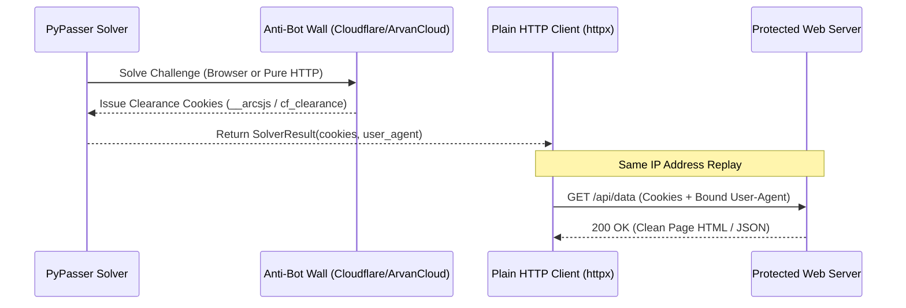

# Anti-Bot Bypasses Overview

Modern web applications protect their infrastructure using anti-bot edge proxies (such as Cloudflare and ArvanCloud). Rather than showing an inline CAPTCHA widget, these systems intercept suspicious visitors with full-page **interstitial challenge walls** ("Just a moment...", JavaScript browser verification).

PyPasser provides specialized bypass modules that clear these walls and extract authenticated session tokens.

---

## Interstitial Bypasses Matrix

| Target | Module Path | Method | Browser Needed? | Clearance Output |
|---|---|---|:---:|---|
| [**Cloudflare Interstitial**](cloudflare.md) | `pypasser.antibot.cloudflare` | Headed stealth browser + token click | **Yes** (headed recommended) | `cf_clearance` cookie + `user_agent` |
| [**ArvanCloud Interstitial**](arvancloud.md) | `pypasser.antibot.arvancloud` | Pure HTTP JSFuck challenge decoder | **No** (pure HTTP) | `__arcsjs` cookie + `user_agent` |

---

## The Cookie Replay Pattern

Both Cloudflare and ArvanCloud bind their clearance cookies to two parameters:

1. **The Client IP Address**: The exit IP that solved the challenge.
2. **The `User-Agent` Header**: The exact browser User-Agent string reported during clearance.

When PyPasser clears an anti-bot wall, it returns the cleared session cookies in `result.cookies` and the matching User-Agent string in `result.user_agent`. You then replay these values with any standard HTTP library (`httpx`, `requests`, `aiohttp`):



### Python Replay Example

```python
import httpx

# After clearing the wall with PyPasser:
result = solver.solve(...)

# Replay cookies over plain HTTP from the same IP:
headers = {
    "User-Agent": result.user_agent,
    "Accept": "text/html,application/xhtml+xml,application/xml;q=0.9,*/*;q=0.8",
}

with httpx.Client(cookies=result.cookies, headers=headers) as client:
    response = client.get("https://protected-site.com/protected-page")
    print("Bypassed status:", response.status_code)
```
