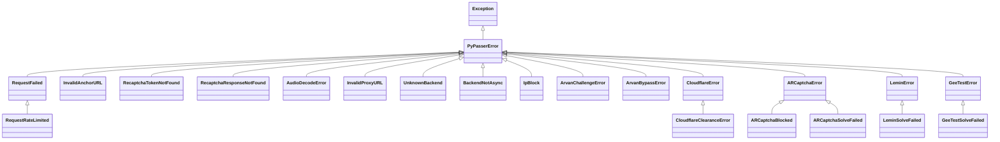

# Exceptions Reference

All exceptions in PyPasser inherit from the base class `PyPasserError`.

---

## Exception Hierarchy



---

## Complete Class Catalog

### Base & Transport Exceptions

| Exception Class | Description |
|---|---|
| `PyPasserError` | Root exception for all PyPasser errors. Catch this to handle any PyPasser failure. |
| `RequestFailed` | Network transport failure, HTTP error, timeout, or CDN unreachable. |
| `RequestRateLimited` | The remote server or mirror pool returned HTTP 429 Too Many Requests or 5xx errors. |
| `InvalidProxyURL` | Malformed proxy string or unsupported protocol scheme. |

---

### Browser Automation Exceptions

| Exception Class | Description |
|---|---|
| `UnknownBackend` | Raised when `backend="auto"` could not identify the browser adapter from the provided `page` object. |
| `BackendNotAsync` | Raised when calling an asynchronous solver (`asolve()`) with a synchronous Playwright page instance. |

---

### reCAPTCHA Exceptions

| Exception Class | Description |
|---|---|
| `InvalidAnchorURL` | The anchor URL is missing required query parameters (`k`, `co`), or neither/both `page` and `anchor_url` were provided. |
| `RecaptchaTokenNotFound` | The initial hidden `recaptcha-token` value was missing from the Google anchor response. |
| `RecaptchaResponseNotFound` | The `rresp` token was missing in Google's reload reply, or Page mode timed out waiting for `#g-recaptcha-response`. |
| `AudioDecodeError` | The downloaded audio challenge file could not be decoded or converted to raw PCM format. |
| `IpBlock` | Google blocked the IP address from requesting audio challenges ("automated queries" error). |

---

### GeeTest Exceptions

| Exception Class | Description |
|---|---|
| `GeeTestError` | Base exception for GeeTest solver errors (e.g., unsupported or invalid `risk_type`). |
| `GeeTestSolveFailed` | Verification was rejected, CV matching failed, or the attempt budget was exhausted. |

---

### Lemin Exceptions

| Exception Class | Description |
|---|---|
| `LeminError` | Base exception for Lemin cropped solver errors. |
| `LeminSolveFailed` | Cutout piece matching failed, pre-validation was rejected, or multi-piece puzzle was requested. |

---

### ARCaptcha Exceptions

| Exception Class | Description |
|---|---|
| `ARCaptchaError` | Base exception for ARCaptcha errors, or missing `site_key` / `domain` parameters. |
| `ARCaptchaBlocked` | ARCaptcha server flagged or blocked the session (`captcha_type == "block"`). |
| `ARCaptchaSolveFailed` | Challenge could not be solved within the attempt budget. |

---

### Anti-Bot Interstitial Exceptions

| Exception Class | Description |
|---|---|
| `CloudflareError` | Base exception for Cloudflare interstitial clearance errors. |
| `CloudflareClearanceError` | Challenge passed but no `cf_clearance` cookie was set (indicates soft IP block or cookie extraction issue). |
| `ArvanChallengeError` | Challenge page HTML or JSFuck script could not be parsed or decoded. |
| `ArvanBypassError` | ArvanCloud challenge was not cleared within the attempt budget. |

---

## Error Handling Best Practices

```python
from pypasser.exceptions import (
    PyPasserError,
    IpBlock,
    RequestRateLimited,
    LeminSolveFailed,
)

try:
    result = lemin.solve(...)
except LeminSolveFailed as exc:
    print(f"Lemin challenge rejected: {exc}")
except RequestRateLimited:
    print("Rate limited by target API. Rotate proxy or back off.")
except IpBlock:
    print("IP blocked by Google. Switch proxy.")
except PyPasserError as exc:
    print(f"General PyPasser failure: {exc}")
```
